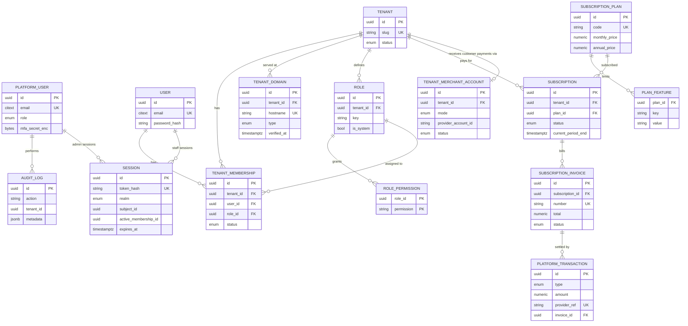
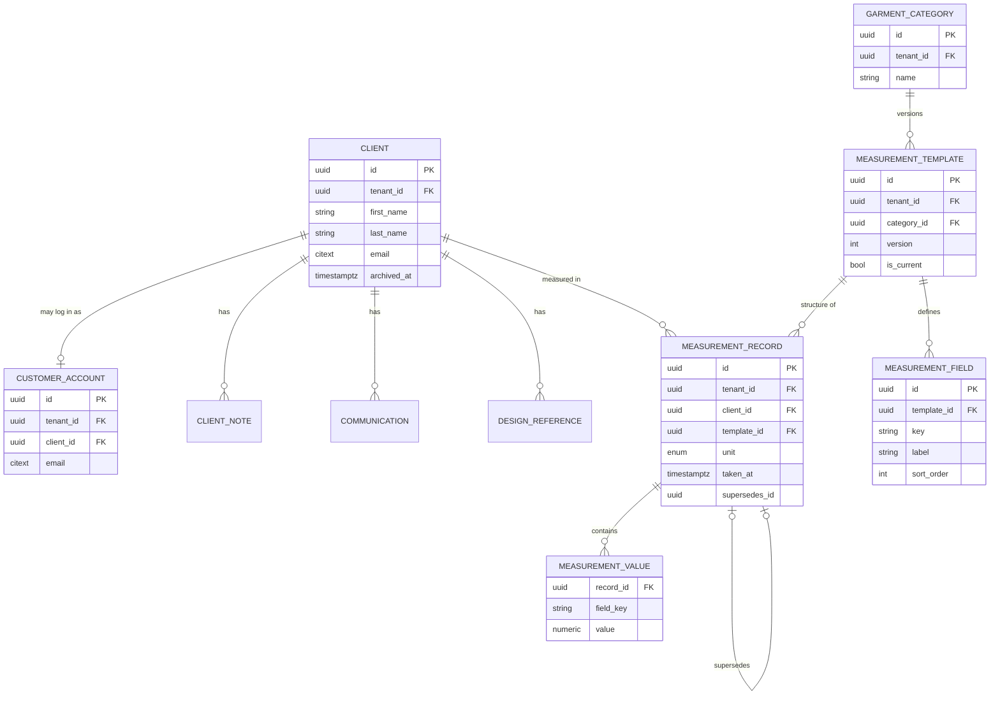
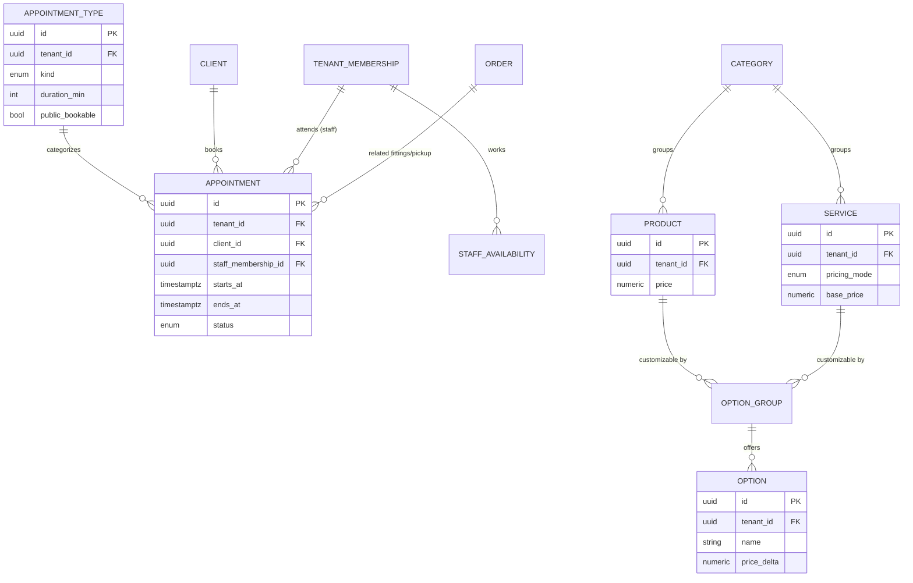
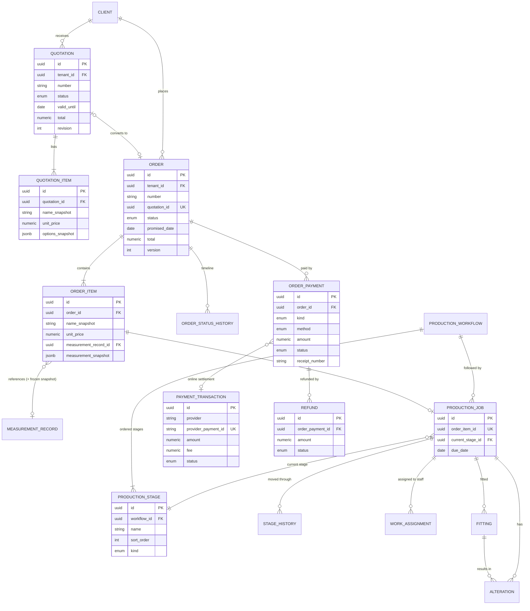
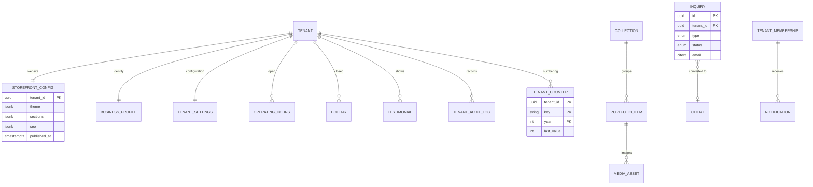

# Database ERD — TAHI.ph

> **Status:** Proposed (Phase 0). These diagrams describe relationships for review. They are not the final Prisma schema.
> Attribute lists are abbreviated; see `DATABASE_DESIGN.md` for fields and constraints.
> Every entity in diagrams 2–5 carries `tenant_id`. Composite FKs `(tenant_id, x_id)` are implied on every tenant-to-tenant relation.

## 1. Platform, identity and subscriptions

## 2. CRM and measurements

## 3. Appointments and catalogue

## 4. Quotations, orders, production and payments

## 5. Storefront, inquiries and system

## 6. Cardinality notes

| Relationship | Rule |
|---|---|
| User ↔ Tenant | Many-to-many via `TenantMembership`. Exactly one `OWNER` membership per tenant (partial unique index). |
| Client ↔ CustomerAccount | 0..1. A customer account is always for one tenant. |
| Quotation ↔ Order | 0..1. `order.quotation_id` is unique. Orders can be created without a quotation. |
| OrderItem ↔ MeasurementRecord | Many-to-0..1 reference **plus** an immutable JSON snapshot copied at order confirmation |
| OrderItem ↔ ProductionJob | 1 : 0..1 (items such as accessories may not need production) |
| Order ↔ OrderPayment | 1 : many. The balance is derived. |
| OrderPayment ↔ PaymentTransaction | Manual payments have none; online payments have exactly one |
| Tenant ↔ Subscription | 1 : many over time. At most one in a non-terminal state (partial unique). |
| Tenant ↔ TenantMerchantAccount | 1 : 0..1 per provider |
