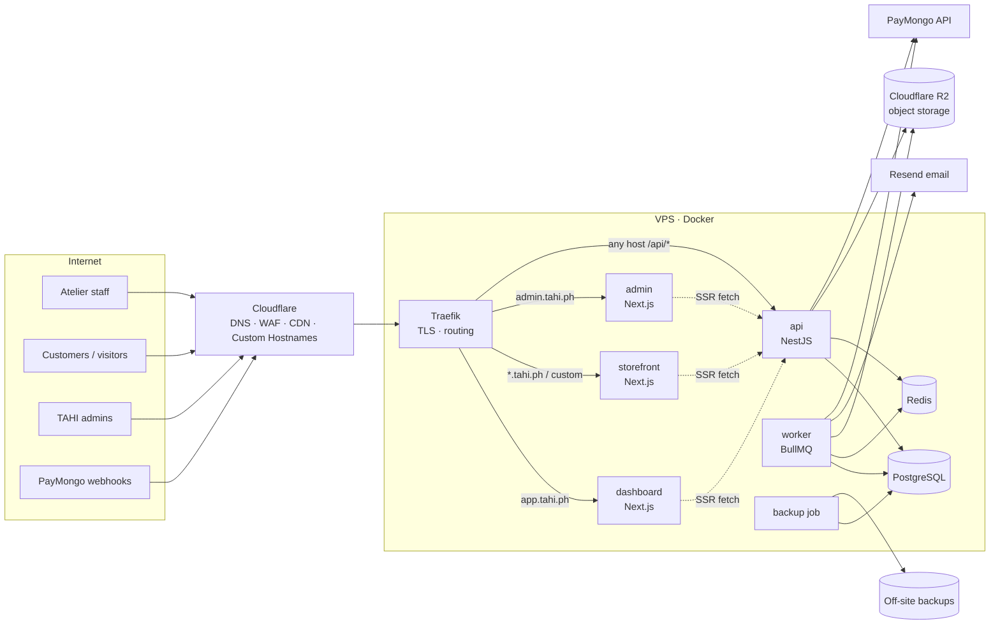

# System Architecture — TAHI.ph

> **Status:** Proposed (Phase 0). Nothing described here is implemented yet.

## 1. Overview

TAHI is a **modular monolith** backend (NestJS) with three Next.js frontends and a background worker, deployed as Docker containers on a single VPS behind Traefik and Cloudflare. The database is a shared PostgreSQL database with a shared schema, isolating tenants with `tenant_id`, application-level scoping and Row-Level Security.



## 2. Monorepo structure

Turborepo + **npm workspaces**, declared in the root `package.json` `"workspaces": ["apps/*", "packages/*"]`. The brief's `npm-workspace.yaml` is a pnpm convention and is not used.

```
tahi/
├── apps/
│   ├── dashboard/        Next.js App Router — tenant workspace (app.tahi.ph)
│   ├── storefront/       Next.js App Router — public tenant sites (Host-based, ISR)
│   ├── admin/            Next.js App Router — platform admin (admin.tahi.ph)
│   └── api/              NestJS modular monolith — two entrypoints:
│                           src/main.ts         → HTTP API container
│                           src/main.worker.ts  → BullMQ worker container
├── packages/
│   ├── database/         Prisma schema, migrations, generated client, tenant-scope extension
│   ├── validation/       Zod schemas — the API contract (request/response)
│   ├── types/            Types inferred from Zod; shared enums & permission catalogue
│   ├── ui/               Design system on shadcn/ui + Tailwind (dashboard, admin)
│   ├── config/           Shared eslint, tsconfig, tailwind presets, prettier
│   └── utils/            Pure helpers: money (decimal), dates/timezones, ids
├── infrastructure/
│   ├── docker/           Dockerfiles per app
│   ├── traefik/          Static + dynamic config, middlewares
│   ├── postgres/         Init SQL: roles, extensions (btree_gist, citext)
│   └── scripts/          backup.sh, restore.sh, deploy.sh, restore-test.sh
├── docs/
├── .github/workflows/
├── docker-compose.yml          Local development (postgres, redis, mailpit, minio)
├── docker-compose.prod.yml     Production
├── turbo.json
├── package.json
├── CLAUDE.md
└── README.md
```

### Deviations from the brief (see `ARCHITECTURAL_DECISIONS.md`)

| Change | Reason |
|---|---|
| `apps/web` split into `apps/dashboard` + `apps/storefront` | Different security posture (authenticated vs public), caching (dynamic vs ISR/CDN), CSP and release cadence (ADR-003) |
| Added `packages/database` | One owner for the Prisma schema, migrations, generated client and tenant-scope extension, shared by the api/worker entrypoints, the `migrate` job and seed scripts |
| Nginx removed, Traefik retained | The brief conflicted. Traefik offers Docker-label routing and automatic ACME (ADR-001). |
| No `npm-workspace.yaml` | npm uses the `package.json` workspaces field |
| No separate `apps/worker` package; the worker is a second entrypoint of `apps/api` | Worker jobs need the same domain services. A second entrypoint reuses them without duplicating code or cross-app imports. It still runs as a separately managed container (ADR-009). |

### Package dependency rules

```
apps/dashboard, apps/admin  → ui, validation, types, utils, config
apps/storefront             → validation, types, utils, config (+ selected ui primitives)
apps/api (api + worker)     → database, validation, types, utils, config
packages/database           → utils
packages/validation         → (zod only)
```

- Frontends **never** import `packages/database`.
- Apps never import each other.
- Business logic lives only in `apps/api` domain modules. The HTTP entrypoint and the worker entrypoint compose those same modules (the worker without controllers). If the worker later needs independent deploys or language, the domain modules get extracted to `packages/domain`.

## 3. Request routing

Traefik routes by host, **and every host forwards `/api/*` to the API**:

| Host | `/api/*` | Everything else |
|---|---|---|
| `app.tahi.ph` | api (realm = tenant staff) | dashboard |
| `admin.tahi.ph` | api (realm = platform) | admin |
| `{slug}.tahi.ph`, custom domains | api (realm = public/customer, tenant from Host) | storefront |
| `api.tahi.ph` | api — webhooks only (`/api/v1/webhooks/*`) | 404 |

Why same-origin `/api`:
- Session cookies are first-party and host-only (`__Host-` prefix), with no cross-subdomain cookie sharing.
- No CORS configuration is required for browser calls.
- The API derives the realm and tenant from the **Host** header, which Traefik passes through. Inbound `X-Forwarded-Host` from clients is stripped.
- Next.js server components call the API over the internal Docker network (`http://api:3000`) and forward the original Host and the session cookie.

## 4. Backend (NestJS)

- **Style:** modular monolith organized by business domain. Each module owns its controllers, services, repositories (where they help) and its slice of the Prisma schema.
- **Layers inside a module:** `controller → service (business rules, transactions) → repository/Prisma`. Controllers contain no business logic.
- **Cross-cutting (`core/`):**
  - `ConfigModule`: environment variables validated with Zod at boot (fail fast).
  - `ContextModule`: `nestjs-cls` (AsyncLocalStorage) holding `RequestContext`.
  - `PrismaModule`: base client plus the tenant-scoped client (see `MULTI_TENANCY.md`).
  - Guards: `RealmGuard`, `SessionGuard`, `PermissionGuard`.
  - `ZodValidationPipe`, global `ExceptionFilter`, response envelope interceptor.
  - Logging with `nestjs-pino` (JSON, request id, tenant id, user id; PII redaction).
  - `ThrottlerModule` with Redis storage.
- **API docs:** OpenAPI generated from the Zod schemas, served at `/api/docs` in non-production only.
- See `API_STANDARDS.md` for the module list and conventions.

## 5. Background worker

- Separate container built from the same `apps/api` image, started with `node dist/main.worker.js`. It uses `NestFactory.createApplicationContext` (no HTTP server) and imports the domain modules without their controllers.
- BullMQ queues, initially: `email`, `notifications`, `reminders`, `billing`, `webhooks`, `media`, `reports`, `maintenance`.
- **Tenant context:** every job payload carries `{ tenantId, actorId?, requestId }`. A base processor restores the CLS context before running the handler, so the same tenant-scoped Prisma client and RLS apply. Platform jobs (e.g. billing runs) carry `realm: 'platform'` and iterate tenants explicitly.
- **Jobs are idempotent:**
  - jobs use deterministic ids where possible (e.g. `reminder:{appointmentId}:24h`);
  - retries use exponential backoff;
  - failed jobs go to a dead-letter queue and are monitored.
- **Scheduled jobs:** BullMQ repeatable jobs (subscription renewal, reminders, reconciliation, restore test trigger, cleanup).

## 6. Frontends

| App | Rendering | Data | Notes |
|---|---|---|---|
| dashboard | Mostly client components inside an RSC shell | TanStack Query against `/api` | React Hook Form + Zod (shared schemas), shadcn/ui, Zustand only for UI state |
| storefront | RSC + ISR, tag-based revalidation | Server fetch to `api:3000/api/v1/public/*` with Host | Theming via CSS variables from `StorefrontConfig`; `next/image` with R2 loader; per-tenant metadata, sitemap and robots |
| admin | Client-heavy | TanStack Query | Strict CSP; MFA |

**Storefront cache invalidation:** when a tenant edits website content, the API enqueues a job that calls the storefront's revalidation endpoint (`revalidateTag('tenant:{id}')`) using a shared internal secret.

## 7. Data and storage

- **PostgreSQL** (major version pinned in Phase 1, 17 or 18, after a Prisma compatibility check). Extensions: `btree_gist` (appointment exclusion), `citext` (emails), `pg_trgm` (client search).
- **Redis:**
  - session cache;
  - rate limiting;
  - BullMQ;
  - tenant-by-host cache.
  
  AOF persistence is enabled. Redis is not a system of record.
- **Object storage:** S3-compatible API. Cloudflare R2 is recommended (no egress fees). Uploads use **presigned PUT URLs** with server-side validation of content type and size; files are confirmed by the API after upload. Private files (measurement photos, payment proofs) are served through short-lived presigned GETs; public media through the CDN.
- **Email:** Resend, through the worker only.

## 8. Scalability path

| Stage | Change |
|---|---|
| 1 (now) | One VPS, Docker Compose, everything co-located |
| 2 | Move PostgreSQL to a managed/dedicated host. Add PgBouncer (transaction mode; compatible with `SET LOCAL`). |
| 3 | Run multiple api/storefront replicas behind Traefik. The worker scales independently. |
| 4 | Read replica for reports; Redis on a dedicated host |
| 5 | Consider schema-per-tenant or database-per-tenant only for very large tenants (the RLS design keeps this possible) |

Kubernetes is explicitly out of scope until there is a demonstrated need.

## 9. Observability (Phase 8, foundations in Phase 1)

- Structured JSON logs, with request id propagated to worker jobs.
- `/api/health/live` and `/api/health/ready` (DB and Redis checks), used by Docker health checks and deploy verification.
- Error tracking: Sentry (self-hosted GlitchTip as an alternative). Decision in Phase 8.
- Uptime monitoring from outside the VPS (e.g. Uptime Kuma on a separate host, or a hosted pinger).
